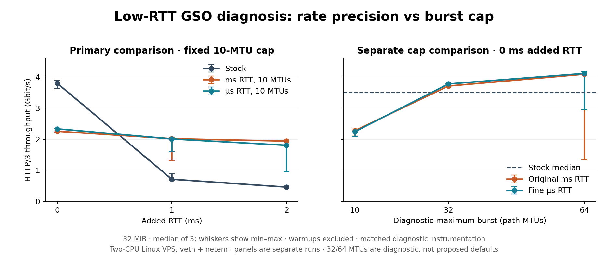

# Focused low-RTT pacing investigation

Generated: 2026-09-06T18:09:51.380541+00:00

## Finding

RTT quantization is present and can materially underestimate the intended
pacing rate. It is **not the main cause of the observed zero-added-RTT GSO
throughput regression with the ten-MTU pacer**.

Changing only the pacing RTT estimator leaves the zero-delay GSO result near
2.3 Gbit/s. Keeping the original millisecond RTT calculation and increasing
the diagnostic cap to 32 MTUs raises it to about 3.7 Gbit/s, with fewer timer
arms and larger GSO calls. This identifies the cap/batching/rescheduling
interaction as the dominant limitation in this measured case.

These findings do not justify selecting 32 or 64 as a new default. The 32-MTU
intervention was tested only at zero added RTT/GSO on, and the 64-MTU variants
have substantial negative cases at 1/2 ms and run-to-run instability.

No production code, tests, commit history or proposed PR structure was changed
during this investigation. All variants are separate diagnostic source copies.

## Scope and measurement

The original two-CPU Hetzner Ubuntu 26.04.1 / Linux 7.0.0-30 KVM host, private
OpenSSL 3.5.8 and curl/ngtcp2 client were reused. Both endpoints run natively
on that Linux host, in owned network namespaces. This is a virtual-network
experiment, not a physical NIC benchmark. The Windows/WSL task was retained.

Single HTTP/3 stream, 32 MiB, TLS AES-128-GCM; added RTT 0, 1 and 2 ms; GSO
off/on; three measured repetitions and one excluded warmup per condition.
Variant order was randomized within each repetition. Both veth qdiscs use
netem delay, no injected loss/rate, and a 1000-entry limit.

Unloaded ICMP mean RTTs were 0.027–0.028, 1.071–1.073 and 2.063–2.065 ms.
Loaded QUIC RTT is measured separately. In GSO-off CPU-limited runs it can
rise to several milliseconds despite zero added propagation delay.

A five-variant comparison changes only the pacing denominator (original
millisecond estimator or measured microsecond shadow EWMA) and cap (10/64).
Recovery, PTO, loss detection and congestion control keep their original
millisecond fields. A subsequent 0-ms/GSO-on pass adds 32 MTUs and repeats
the controls, with loss and UDP error counters.

All diagnostic variants carry the same timestamp and sampled-trace overhead.
Records remain in a fixed process buffer and are written only at exit,
after throughput/CPU collection. The shadow EWMA receives the same eligible
largest-newly-ACKed-packet samples as nginx. See DESIGN.md for implementation
scope, ACK-delay handling and timestamp placement.

## Primary focused comparison

HTTP/3 Mbit/s, median of three; warmups excluded. These results are not pooled
with the subsequent 32-MTU pass or any earlier benchmark campaign.

| Added RTT | GSO | Stock | ms10 | us10 | ms64 | us64 |
| ---: | :--- | ---: | ---: | ---: | ---: | ---: |
| 0 ms | off | 1181.8 | 1070.2 | 1172.5 | 965.9 | 1166.5 |
| 0 ms | on | 3802.8 | 2254.7 | 2333.4 | 832.9 | 3029.6 |
| 1 ms | off | 1025.3 | 769.7 | 812.4 | 976.6 | 1038.1 |
| 1 ms | on | 712.4 | 2014.8 | 2007.5 | 615.7 | 748.2 |
| 2 ms | off | 1099.9 | 842.1 | 895.3 | 1055.9 | 1060.5 |
| 2 ms | on | 459.5 | 1939.4 | 1803.3 | 451.2 | 442.5 |

ms10 is the current pacer. us10 changes only its rate denominator to the
microsecond shadow EWMA. ms64/us64 additionally change the maximum burst to
64 path MTUs; the rate-derived bucket bound, cwnd and GSO buffer limits remain.

With GSO off, the fine-RTT intervention gives observed median gains of 9.6%,
5.5% and 6.3% at 0/1/2 ms; ranges often overlap. It does not consistently
recover stock throughput. This is evidence of a secondary rate-accuracy
effect, not a statistically established universal improvement.

With GSO on, ms10 versus us10 is 2254.7→2333.4 Mbit/s at 0 ms, 2014.8→2007.5
at 1 ms and 1939.4→1803.3 at 2 ms. Thus a finer RTT does not remove the
low-delay GSO regression at the current cap. At 1/2 ms, the ten-MTU variants
also substantially outperform stock in this particular virtual topology.

## What the RTT and rate records show

nginx stores RTT in milliseconds and updates its average as:

~~~c
qc->avg_rtt += (adjusted_rtt >> 3) - (qc->avg_rtt >> 3);
~~~

If both values are below 8 ms, both shifted terms are zero. The average can
therefore retain its initial value even as sub-ms samples change. Later
larger samples can move it into another bucket. This is stronger quantization
than simply rounding each RTT to a millisecond. The pacer also floors its
rate denominator to 1 ms.

Zero-added-RTT/GSO-on results from the primary pass follow. Each entry is
the median of the per-run sampled medians. cwnd and rate are independently
sampled medians, not a single synchronized synthetic state.

| Variant | ACK RTT µs | Commit-to-ACK µs | Fine SRTT µs | avg_rtt ms | cwnd bytes | Actual rate bytes/ms | Requested wait µs |
| --- | ---: | ---: | ---: | ---: | ---: | ---: | ---: | ---: |
| stock | 193 | 185 | 192 | 2 | 232,323 | N/A | N/A |
| ms10 | 67 | 59 | 65 | 2 | 16,762,938 | 16,762,938 | 1 |
| us10 | 67 | 59 | 65 | 2 | 17,193,804 | 533,339,809 | 1 |
| ms64 | 51 | 45 | 39 | 2 | 125,322 | 106,727 | 1 |
| us64 | 357 | 351 | 339 | 1 | 63,079 | 196,038 | 1 |

The original ms10 estimator is typically 1–2 ms while the measured fine SRTT
is about 65 µs. However, its large slow-start cwnd already makes the median
calculated pacing rate about **134 Gbit/s**, far above the measured
**2.25 Gbit/s** transfer. Using fine RTT increases the calculated rate still
further, but accumulated credit remains capped at ten MTUs.

In the three ms10 transfers, 98.5–99.9% of sampled scheduled waits are already
the **1-µs minimum**. There are about 2,900 timer arms and 2,900 GSO calls for
32 MiB, averaging about ten segments per GSO call. Stock averages about
46–49 segments per call and has no pacing timer. A higher rate cannot reduce
an already-minimum requested wait or enlarge this capped bucket.

Microsecond deadline precision does not imply a one-microsecond completed
event-loop round trip. These records support the batching/rescheduling
explanation; they do not directly measure kernel wakeup latency.

## Separate 32-MTU confirmation

This is a new zero-added-RTT/GSO-on pass. It is kept separate because the
64-MTU outcomes are variable across runs.

| Variant | Mbit/s median [min–max] | CPU s | Segments/GSO call | Timer arms/MiB |
| --- | ---: | ---: | ---: | ---: |
| stock | 3495.8 [3464.3–3723.4] | 0.05 | 45.4 | 0.0 |
| ms10 | 2275.2 [2101.3–2332.3] | 0.08 | 9.9 | 91.6 |
| us10 | 2242.5 [2090.8–2254.5] | 0.09 | 10.0 | 89.5 |
| ms32 | 3708.7 [3678.8–3786.5] | 0.06 | 30.7 | 30.8 |
| us32 | 3775.9 [3723.8–3790.4] | 0.06 | 31.6 | 28.9 |
| ms64 | 4089.6 [1349.1–4095.6] | 0.05 | 31.3 | 15.7 |
| us64 | 4113.3 [2950.1–4174.2] | 0.06 | 31.6 | 14.6 |

With the original millisecond rate calculation, ms32 improves over ms10 by
**63.0%**, changes average GSO batch size from 9.9 to 30.7 segments, and reduces
timer arms from 91.6 to 30.8 per MiB. CPU time falls from approximately
0.08 to 0.06 seconds per 32 MiB. us32 is only 1.8% above ms32 in this pass.

The ms10 and ms32 measured ranges do not overlap here. The evidence therefore
supports a substantial cap contribution even without changing RTT resolution.
The fact that this 32-MTU variant exceeds stock in this sample does not
establish a general throughput win or safe production burst policy.

Loss counters in this pass provide an additional limitation:

- All measured 10- and 32-MTU transfers have zero server congestion reductions,
  zero resend events, and zero client UDP receive-buffer errors.
- Each stock transfer has one congestion reduction and 93–204 resend events;
  client UDP receive-buffer error counters increase by 2–5.
- The slow ms64 transfer (1349.1 Mbit/s) has one reduction, 55 resend events
  and one client receive-buffer error. Its two fast repetitions have none.
- The slower us64 repetition (2950.1 Mbit/s) similarly has one reduction,
  55 resend events and one receive-buffer error; its faster two have none.

All recorded qdisc drop deltas are zero. A receive-buffer error count can
refer to an aggregated skb and must not be called a count of lost wire packets.
The initial 0/1/2-ms pass did not collect these extra socket/loss counters;
its 64-MTU negative cases must not automatically be attributed to that same
mechanism. Its cwnd and rate traces do show much smaller windows in the slow
large-cap runs, making RTT-rate accuracy relevant after reductions.

## CPU and instrumentation limits

The original zero-delay GSO comparison uses roughly 0.05 seconds of server
CPU for stock versus 0.08 seconds for ms10/us10 per 32 MiB. The separate burst
check reproduces approximately that cost. Larger GSO batches reduce the
number of output opportunities, but their loss/queue trade-offs remain.

An independent zero-delay/GSO-on overhead check gives:

- stock: instrumented median 3079.5 versus uninstrumented 3697.8 Mbit/s;
- ms10: instrumented median 2208.5 versus uninstrumented 2307.3 Mbit/s.

Ranges vary and overlap for stock; the apparent differences are about 16.7%
and 4.3%. Instrumentation is therefore not free. Causal comparisons use
matched instrumentation, and precise percentage effects should not be
generalized beyond these short runs. The uninstrumented comparison also
retains the zero-delay GSO regression. CPU uses 10-ms /proc ticks, so 0.01-s
differences are coarse. This is not a power or whole-machine CPU measurement.

## Smallest justified engineering response

Do not widen the PR into an RTT/recovery rewrite on the claim that it fixes
the zero-delay GSO regression. The rate is already nonbinding for almost all
of that ten-MTU transfer; the supported primary concern is the burst and
rescheduling policy. Do not replace 10 with 32/64 just because one condition
improves.

If fine RTT for pacing is pursued independently, the smallest defensible
design is a pacing-only fine RTT estimator: retain a monotonic timestamp for
the sampled sent packet, propagate it with the eligible ACK sample, preserve
ACK-delay precision and the RFC sampling/minimum-RTT rules, and maintain an
integer fine-unit EWMA. Feed only pacing with that value; keep recovery/PTO
milliseconds unchanged. Reset the new state on path RTT reset and preserve
send rollback/retransmission semantics. Unit tests must cover ACK eligibility,
ACK delay, startup, integer overflow, path reset and clock behavior.

Simply multiplying avg_rtt by 1000 does not recover lost precision. Changing
only the old EWMA expression does not supply sub-ms send/receive timestamps.
The diagnostic shadow estimator and its wide intermediate are not a reviewed
portable implementation of this proposed design.

For the present work, retain the validated branch and disclose this result.
Further burst-policy design would need an explicit decision and broader
trade-off evaluation; it has not been silently folded into the PR.

## Evidence, validity and cleanup

169 completed successful transfers: 120 in the focused matrix (90 measured,
30 warmups), 16 in the instrumentation comparison (12/4), 28 in the burst
confirmation (21/7), plus five functional smoke transfers. Every transfer
checks HTTP/3, HTTP 200 and the full expected byte count. No trace buffer
overflow occurred. No full suite or old expensive benchmark matrix was rerun.

All seven diagnostic builds succeeded. A first configure attempt pointed to
lib64 instead of the actual private OpenSSL lib directory; it was corrected.
An early smoke guard ran while builds were pending; it performed no transfer.
Those status/log artifacts are retained. There were no failed final transfers.
These are diagnostic build/transfer checks, not a new sanitizer certification.

The final source base is nginx 231a60ee3e90a43b829b9ca0a3013a8359b98d7e plus
validated-cleanup-base.patch. Source generators and separate diagnostic patches
are included. Initial and burst-pass binary hashes are in their metadata.
The original branch has no diagnostic code and no new commit. The prior
cleanup had only removed one budget debug log and adjusted timer declaration
alignment; those changes predate this focused investigation.

Test processes and owned namespaces are stopped. No public-interface qdisc,
firewall, SSH setting, push or PR was changed. Server source/logs remain.

- DESIGN.md: pre-run design and bounded scope.
- evidence/matrix-summary.tsv: all requested RTT/cwnd/rate/delay/CPU metrics.
- evidence/burst-check-summary.tsv and evidence/overhead-summary.tsv: separate passes.
- evidence/*/focused-summary.json: ranges and per-run sampled distributions.
- evidence/*/*/trace.csv: sampled synchronized raw records.
- evidence/*/*/result.json: throughput, CPU, qdisc and available UDP/loss counters.
- BRANCH-STATUS.json: preserved branch/source hashes.
- SHA256SUMS: delivered-file verification.

AI assistance: Codex prepared the diagnostic changes, ran the tools and
analysed the recorded results. No independent human review is implied.
